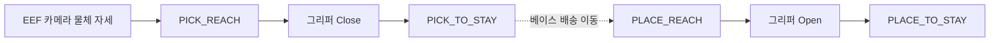

# OMX Arm-Only RL Training

`omx_train_ws`는 TurtleBot3 Waffle Pi와 OpenMANIPULATOR-X를 사용하는 배송 로봇의 **팔 전용 PPO 학습 저장소**다. 정책은 `joint1`~`joint4`만 제어하며, 베이스 이동과 그리퍼 개폐는 런타임 상태 머신이 담당한다.

## 학습 임무



학습 episode에는 베이스 바퀴 주행을 넣지 않는다. 픽업과 배송 위치에서 로봇이 동일 규격 타워를 같은 상대 자세로 바라본다고 가정하고, 타워 하나를 두 phase에 재사용한다. 대신 연속 배송 episode가 파지된 Stay를 일정 시간 유지한 뒤 배송 위치 도착 handoff를 발생시킨다.

현재 구현은 `PICK_REACH → GRIPPER_CLOSE → PICK_TO_STAY → TRANSPORT_HOLD → PLACE_REACH → GRIPPER_OPEN → PLACE_TO_STAY` 전체를 하나의 성공 계약으로 포함한다. 물체 자세는 EEF 영상 자체가 아니라 실제 로봇의 `omx_eef_vision`이 발행하는 ArUco 기반 `base_link` 좌표와 같은 형식으로 정책에 들어간다.

## 장면 계약

| 요소 | 값 |
|---|---|
| 모델 | `assets/mjcf/turtlebot3_manipulator/scene.xml` |
| 작업 타워 | `13 × 13 × 17 cm` |
| 배송 상자 | `6 × 5.5 × 5.5 cm` |
| 타워 중심 | `[0.27, 0.0, 0.085] m` |
| 상자·배치 목표 중심 | `[0.27, 0.0, 0.1975] m` |
| MuJoCo 계약 | `nq/nv/nu = 8/8/5` |
| Stay 팔 자세 | `[0.104311, 0.027612, -0.001534, -1.638291] rad` |
| 정책 action | 4차원 잔차 보정 + 접근 중 `joint4` pitch coupling |
| 관측 계약 | 33차원, phase 포함 |
| PPO 장치 | CUDA GPU (`cuda`) |

## 제어 구조

현재 학습 코드는 관절 목표 전체를 PPO에 맡기지 않는다. ArUco 위치로 계산한 충돌 회피 관절 경로가 기준 명령을 만들고, PPO는 각 축에 `[-0.1, 0.1]` 범위의 보정만 더한다. 물체 접근 중에는 C++ joint-nudge 제어와 같이 `joint4 = target_pitch - joint2 - joint3` 관계를 제한된 step으로 추종해 그리퍼와 EEF 카메라의 pitch를 유지한다. 파지 gate가 처음 성립하면 기준 자세를 고정해 연속 검출을 기다리고, 그리퍼 close와 파지 후 Stay 복귀는 같은 상태 머신 계약을 사용한다.

```text
control_action = clip(reference_action + 0.10 * ppo_action, -1, 1)
joint_target += low_pass(control_action, 0.18) * 0.014 rad
joint4_target -> clip_step(-(joint2_target + joint3_target), 0.028 rad)
```

현재 배포 후보 `arm_delivery_pitch_hold_v4`의 action schema는 `v3`다. 실제 로봇에서도 기준 경로, 필터, 스케일과 joint4 coupling을 재현하지 않으면 정책만 단독으로 실행할 수 없다.

## 비정형 물체 위치

상자 중심은 매 episode마다 타워 상면에서 달라진다. 상자 yaw에 따른 회전 footprint를 계산해 네 모서리가 타워를 벗어나지 않는 위치만 허용하고, 전체 표본의 `40%`는 가장자리 구간에서 뽑는다. 설정 범위는 중심 기준 최대 `±24 mm`지만 실제 샘플 한계는 회전된 상자 footprint에 따라 축별로 줄어든다.

```text
center_reach         -> 중앙 ±4 mm에서 접근·파지 학습
grasp_return_center  -> 파지된 자세에서 Stay 복귀 학습
center_mixed         -> 접근 episode와 Stay 복귀 episode를 50:50 혼합
full_tower           -> 안전 상면 전체 ±24 mm + 임의 yaw
aruco_robust         -> 위치/yaw 오차, 2-step 갱신, 짧은 dropout 추가
place_full_tower     -> 배송 타워 전개, 상자 해제, 빈 팔 Stay 복귀
pick_place_mixed     -> 파지와 배송 episode를 50:50 혼합
delivery_center      -> 중앙에서 PICK부터 PLACE까지 한 episode로 학습
delivery_full_tower  -> 전체 상면에서 연속 배송과 위치 분리 목표 학습
delivery_sim2real_robust -> 연속 배송에 Vision·형상·동역학 교란 동시 적용
base_stop_robust     -> 타워 상대 정지 위치 X ±12 mm, Y ±20 mm
height_robust        -> 타워 높이 ±15 mm, 상자 크기 95~105%
sim2real_robust      -> 동역학·마찰·명령 지연·Vision 오차 동시 랜덤화
```

Stay에서 상자로 바로 관절을 펴면 차체 상판과 충돌하므로, `PICK_REACH` 내부에서 차체 위 안전점과 전방 안전점을 순서대로 통과한다. EEF 파지 기준은 상자 중심보다 `22.5 mm` 위이며, 그리퍼는 파지 gate를 연속 통과하기 전까지 `0.019 m` 최대 개방을 유지한다.

MJCF와 필요한 STL은 저장소 안에 함께 보관한다. 정확한 해시는 `assets/mjcf/turtlebot3_manipulator/model_manifest.yaml`에서 확인한다.

## 디렉터리

```text
assets/       MuJoCo 장면, mesh, 모델 manifest
configs/      장면·관절 한계·PPO 계약
docs/         학습, 평가, Sim2Real 계획
envs/         Gymnasium 환경
train/        PPO 학습 진입점
eval/         고정 seed 및 randomization 평가
policies/     checkpoint와 배포 artifact
ros_export/   ROS 2 추론 패키지용 export
scripts/      모델·정책 계약 검사
```

### 문서 읽는 순서

1. [`01. 팔 전용 PPO 학습 설계.md`](docs/01.%20팔%20전용%20PPO%20학습%20설계.md) — 환경·관측·행동·보상·배포 계약
2. [`02. 비정형 파지 PPO 1차 학습 결과.md`](docs/02.%20비정형%20파지%20PPO%201차%20학습%20결과.md) — 전체 타워 파지와 ArUco 강건화 1차 결과
3. [`03. 팔 배송 PPO 학습 및 안정화 기록.md`](docs/03.%20팔%20배송%20PPO%20학습%20및%20안정화%20기록.md) — Pick/Place curriculum과 단계별 최고 모델 선택
4. [`04. 팔 배송 PPO v2 최종 평가.md`](docs/04.%20팔%20배송%20PPO%20v2%20최종%20평가.md) — 배송 v2 모델의 독립 평가와 한계
5. [`05. 실제 Stay 기준 PPO v3 재학습 기록.md`](docs/05.%20실제%20Stay%20기준%20PPO%20v3%20재학습%20기록.md) — 실제 로봇 Stay 자세를 적용한 재학습 결과
6. [`06. 현재 v3 모델 분석과 PICK-TRANSPORT-PLACE 재학습 계획.md`](docs/06.%20현재%20v3%20모델%20분석과%20PICK-TRANSPORT-PLACE%20재학습%20계획.md) — PICK 전용 배포 모델의 정확한 한계와 연속 배송 성공 계약
7. [`07. 연속 배송 pitch-hold PPO v4 재학습 결과.md`](docs/07.%20연속%20배송%20pitch-hold%20PPO%20v4%20재학습%20결과.md) — 새 모델의 학습, 100회 평가, 뷰어 및 artifact 결과
8. [`08. 2단 서랍 물품 인출 및 팔로워 봇 적재 고도화 계획.md`](docs/08.%202단%20서랍%20물품%20인출%20및%20팔로워%20봇%20적재%20고도화%20계획.md) — 기존 weight를 쓰지 않는 신규 서랍 모델과 TurtleBot3 platooning follower 상면 적재 환경 계획

## 검증과 학습

```bash
cd /home/ktj/omx_train_ws
uv run --frozen python scripts/test_load_model.py
uv run --frozen python scripts/check_grasp_env.py --stage full_tower --samples 20
```

첫 명령은 모델, 자유도, 타워·상자 치수와 1000-step 시뮬레이션을 확인한다. 두 번째 명령은 33/4 관측·행동 계약과 무작위 상면 위치의 충돌 없는 파지 가능성을 확인한다.

```bash
# PPO 파이프라인 1-rollout 검사
uv run --frozen python -m train.train_grasp_ppo \
  --smoke --n-envs 2 --output-dir /tmp/omx_grasp_residual_smoke

# 비정형 전체 상면 학습
uv run --frozen python -m train.train_grasp_ppo \
  --stage full_tower --output-dir policies/latest/arm_grasp_residual

# ArUco 오차 강건화 재개 학습
uv run --frozen python -m train.train_grasp_ppo \
  --stage aruco_robust \
  --resume policies/latest/arm_grasp_residual/arm_grasp_latest.zip \
  --output-dir policies/latest/arm_grasp_residual

# 최종 연속 배송 정책의 전체 Sim2Real 평가
uv run --frozen python -m eval.evaluate_grasp_policy \
  --policy policies/latest/arm_delivery_pitch_hold_v4/arm_grasp_latest.zip \
  --stage delivery_sim2real_robust --episodes 100 --seed 20260802 \
  --device cuda

# PICK → 운송 대기 → PLACE 전체 정책 재생
uv run --frozen python scripts/view_grasp_policy.py
```

## 현재 기준 결과

평가 seed `20260802`를 사용한 `arm_delivery_pitch_hold_v4` 결정론적 100 episode 결과다.

| 평가 조건 | 성공률 | 파지 완료 | release | 충돌률 |
|---|---:|---:|---:|---:|
| 전체 타워 PICK | `100%` | `100%` | - | `0%` |
| 전체 타워 PLACE | `100%` | 시작 시 파지 | `100%` | `0%` |
| PICK/PLACE 혼합 | `100%` | PICK `100%` | PLACE `100%` | `0%` |
| 연속 배송 전체 타워 | `100%` | `100%` | `100%` | `0%` |
| 연속 배송 Sim2Real | `98%` | `99%` | `99%` | `2%` |

선택된 체크포인트의 SB3 누적 counter는 `627,232`이며 정책 SHA-256은 `ce5403ddffaf69181801400959824700346d28b64bb559bab93fcdbe16f9aafb`다. 배포 artifact는 `policies/exported/arm_delivery_pitch_hold_v4/`와 `ros_export/arm_delivery_pitch_hold_v4/`에 동일하게 보관한다. 일반 연속 배송은 100회 모두 성공했지만 Sim2Real 충돌 2건이 남아 있으므로 실제 로봇에서는 중앙·저속 검증부터 진행해야 한다. 상세 근거는 `docs/07. 연속 배송 pitch-hold PPO v4 재학습 결과.md`에 정리했다.

## MuJoCo 뷰어 영상

