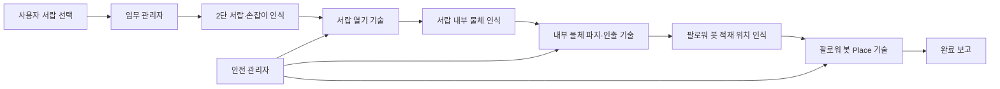

# 2단 서랍 물품 인출 및 팔로워 봇 적재 고도화 계획

| 항목 | 내용 |
|---|---|
| 문서 상태 | 초기 기획안 |
| 작성일 | 2026-10-12 |
| 대상 로봇 | TurtleBot3 Waffle Pi + OpenMANIPULATOR-X |
| 신규 정책 가칭 | `drawer_transfer_v1` |
| 학습 시작점 | 기존 weight를 불러오지 않는 신규 PPO 모델 |
| 신규 목표 | 사용자 지정 서랍을 열고 내부 물체를 꺼내 팔로워 봇에 적재 |
| 서랍 구조 | 상단·하단으로 구성된 2단 서랍 |
| 팔로워 현황 | 기존 TurtleBot3 platooning follower URDF/Xacro 확인, 본체 상면을 적재면으로 사용 |

## 1. 프로젝트 목표

사용자가 `1번` 또는 `2번` 서랍을 선택하면 로봇이 선택된 서랍만 인식하고,
손잡이를 잡아 서랍을 연 뒤 내부 물체를 파지해 옆의 팔로워 봇 적재 공간에
안전하게 내려놓는 것을 최종 목표로 한다.

```text
사용자 서랍 번호 선택
  → 선택 서랍 확인
  → 손잡이 인식
  → 서랍 열기
  → 서랍 내부 물체 인식
  → 물체 파지 및 인출
  → 팔로워 봇 적재 위치 확인
  → 물체 내려놓기
  → Stay 복귀 및 완료 보고
```

단순히 현재 모델의 목표 좌표만 서랍 안으로 바꾸는 작업은 아니다. 기존
`arm_delivery_pitch_hold_v4`는 열린 공간의 타워 위 물체를 집어 다른 타워에
놓는 정책이다. 닫힌 서랍, 손잡이 접촉, 서랍의 prismatic 운동, 좁은 내부
공간과 인출 동작은 학습 분포에 없으므로 별도의 환경과 재학습이 필요하다.

이번 프로젝트는 기존 v4 checkpoint를 이어 학습하지 않는다. 새로운 scene,
관측 schema, phase와 reward를 사용하는 `drawer_transfer_v1`을 처음부터
학습한다. v4는 회귀 비교용 기준선으로만 보존한다.

## 2. 사용자 관점의 임무

### 2.1 서랍 번호 규칙

초기 규칙은 다음과 같이 고정한다.

| 사용자 입력 | 대상 | 내부 ID |
|---|---|---|
| `1` | 상단 서랍 | `TOP_DRAWER` |
| `2` | 하단 서랍 | `BOTTOM_DRAWER` |

UI에는 숫자뿐 아니라 `1번 서랍(상단)`, `2번 서랍(하단)`을 함께 표시해
오선택을 줄인다. 선택 결과는 로봇 동작 전에 다시 화면이나 음성으로 확인한다.

### 2.2 정상 시나리오

1. 사용자가 서랍 번호를 선택한다.
2. 주행 로봇이 서랍장 앞의 기준 정지 위치로 이동한다.
3. 선택된 서랍과 손잡이의 ID·자세를 확인한다.
4. 팔이 손잡이에 접근하고 그리퍼를 닫는다.
5. 손잡이를 일정 방향으로 당겨 목표 개방량까지 서랍을 연다.
6. 손잡이를 놓고 서랍 내부의 물체를 다시 인식한다.
7. 팔이 열린 서랍 내부로 진입해 물체를 잡는다.
8. 물체를 서랍 밖 안전점으로 꺼낸 뒤 Stay 또는 운반 자세로 복귀한다.
9. 팔로워 봇이 지정된 적재 위치에서 정지했음을 확인한다.
10. 팔로워 봇의 적재함 위 목표 위치로 이동해 물체를 내려놓는다.
11. 빈 팔로 Stay 자세에 복귀하고 성공 상태를 사용자에게 알린다.

## 3. 권장 시스템 구조

하나의 PPO가 사용자 입력부터 모든 동작을 결정하게 하지 않는다. 사용자 명령,
인식 유효성, 단계 전환과 안전 정지는 결정론적 상태 머신이 담당하고, PPO는
연속적인 팔 동작 기술을 담당하는 계층형 구조를 사용한다.



### 3.1 상위 계층: 임무 관리자

- 사용자 입력 `drawer_id=1|2` 검증
- 선택되지 않은 서랍 동작 금지
- 로봇과 팔로워 봇의 정지 상태 확인
- 각 인식 결과의 좌표계와 timestamp 검사
- 기술 정책 실행 순서 관리
- timeout, 재시도, HOLD, FAULT, E-Stop 관리
- 사용자에게 현재 단계와 실패 원인 제공

### 3.2 하위 계층: 하나의 신규 phase-conditioned 정책

`drawer_transfer_v1` 하나가 다음 세 학습 phase의 연속 관절 동작을 담당한다.

| 학습 phase | 입력 목표 | 성공 조건 |
|---|---|---|
| `DRAWER_OPEN` | 선택 서랍의 손잡이 자세 | 손잡이 파지 후 목표 개방량 도달 |
| `DRAWER_PICK` | 열린 서랍 내부 물체 자세 | 물체를 잡아 서랍 밖 안전점으로 인출 |
| `FOLLOWER_PLACE` | 기존 팔로워 본체 상면의 적재 목표 자세 | 물체 release 후 팔이 안전하게 이탈 |

Curriculum 단계에서는 phase별 checkpoint를 만들지만 최종 산출물은 공통
actor와 phase 관측을 사용하는 하나의 정책으로 만든다. 상태 머신은 phase를
선택하고 그리퍼 사건과 안전 전이를 관리한다. 학습은 기존 v4 weight를 load하지
않고 무작위 초기화에서 시작한다.

## 4. 기존 v4와의 경계

새 모델은 기존 weight와 관측 계약을 재사용하지 않는다. 다만 검증된 소프트웨어
설계 원칙은 새 코드 작성 시 참고할 수 있다.

| 항목 | 신규 모델 적용 방침 |
|---|---|
| 기존 v4 weight | 사용하지 않음 |
| 기존 33차원 관측 | 사용하지 않고 drawer schema v1을 새로 정의 |
| 기존 타워 scene·reward | 사용하지 않음 |
| 기존 artifact 디렉터리 | 수정하지 않고 rollback 기준선으로 보존 |
| 4개 팔 관절 residual 형식 | 새 환경에서 타당성을 다시 검증한 뒤 채택 가능 |
| `joint1` 방위 정렬 개념 | 새 reference controller에 다시 구현 가능 |
| 그리퍼/카메라 pitch 유지 개념 | phase별 목표 pitch로 새로 구현 가능 |
| Stay·gate·안전 제한 구조 | 코드 설계 참고용이며 수치는 새로 검증 |

서랍 내부는 기존 작업공간과 충돌 형상이 다르고, 손잡이를 잡은 상태에서 외부
물체를 당기는 동작은 현재 action·reward 계약에 포함되어 있지 않다. 따라서
새 모델의 성능을 v4가 보장한다고 해석하지 않는다.

## 5. 2단 서랍의 인식 설계

### 5.1 권장 마커 구성

초기 시뮬레이션과 실기 검증은 ArUco 기반으로 시작한다.

| 대상 | 권장 식별자 | 목적 |
|---|---|---|
| 서랍장 본체 | `cabinet_marker` | 서랍장 기준 좌표계 생성 |
| 상단 서랍 | `drawer_1_marker` | 1번 서랍 식별과 전면 자세 추정 |
| 하단 서랍 | `drawer_2_marker` | 2번 서랍 식별과 전면 자세 추정 |
| 각 손잡이 | 서랍별 고유 marker 또는 고정 TF | 손잡이 파지 목표 계산 |
| 내부 물체 | 물체별 marker 또는 객체 검출 | 물체 중심·yaw 추정 |
| 팔로워 적재함 | `follower_tray_marker` | Place 목표 좌표 계산 |

마커 ID만으로 동작하지 않고, 선택된 `drawer_id`와 검출된 marker ID가 일치할
때만 팔 전개를 허용한다. 2개 서랍이 동시에 보이더라도 선택되지 않은 서랍의
pose는 참고 정보일 뿐 동작 목표가 되지 않는다.

### 5.2 인식 단계 분리

서랍이 닫혀 있을 때는 내부 물체가 보이지 않으므로 인식은 두 번 수행한다.

1. 서랍 열기 전: 서랍장, 선택 서랍과 손잡이 인식
2. 서랍 개방 후: 손잡이 목표를 해제하고 내부 물체를 새로 탐색

서랍을 연 뒤 기존 물체 pose를 재사용하지 않는다. 카메라 관점, 가림과 조명이
바뀌므로 새로운 timestamp의 유효한 물체 pose가 필요하다.

## 6. 2단 서랍 기구와 작업공간 조건

MuJoCo 서랍장은 다음 요소를 가져야 한다.

- 고정된 서랍장 본체
- 상단·하단 서랍 각각의 prismatic joint
- 서랍별 손잡이 collision geom과 grasp 가능한 크기
- 개방 범위와 end stop
- 서랍 내부 바닥·측면·후면 collision
- 서랍 내부의 free object
- 로봇 옆 팔로워 봇과 적재함 collision

### 6.1 확인된 팔로워 로봇 모델과 적재면

실제 로봇 워크스페이스에는 이미 팔로워 시뮬레이션 모델이 있다. 신규
`follower_proxy`를 만드는 대신 다음 모델을 MuJoCo용 MJCF로 변환해 그대로
Place 대상으로 사용한다.

| 구분 | 확인된 경로·값 |
|---|---|
| 팔로워 래퍼 | `/home/ktj/turtlebot3_ws/src/turtlebot3_simulations/turtlebot3_manipulation_gazebo/urdf/turtlebot3_platooning_follower.urdf.xacro` |
| 본체 Xacro | `/home/ktj/turtlebot3_ws/install/turtlebot3_manipulation_description/share/turtlebot3_manipulation_description/xacro/turtlebot3_platooning.xacro` |
| 모델 | TurtleBot3 Waffle Pi 기반, 링크 prefix `follower_` |
| 시뮬레이션 설정 | Gazebo 래퍼에서 `<static>true</static>` |
| Place 기준 frame | `follower_base_footprint` |
| 기존 Place 중심 | `[0.0, 0.0, 0.12] m` |
| 기존 적재 물체 | `[0.06, 0.06, 0.10] m` |

이 모델에는 별도의 `cargo_deck_link`나 트레이 측벽이 없다. `base_link`의 box
collision은 `0.266 × 0.266 × 0.060 m`이며, `base_footprint`에서 `base_link`가
`z=0.010 m`, collision 중심이 다시 `z=0.030 m`이므로 상면은
`follower_base_footprint` 기준 `z=0.070 m`이다. 기존 높이 `0.10 m` 물체의
중심을 `z=0.12 m`에 두면 물체 바닥도 `z=0.070 m`가 되어 상면과 일치한다.

따라서 초기 MuJoCo 학습에서는 팔로워의 주행을 학습하지 않고 다음과 같이
운용한다.

- 실제 팔로워 URDF의 링크·collision·기준 좌표를 MJCF에 반영
- 팔로워 전체는 episode 동안 고정하고 리더 로봇과의 상대 X/Y/yaw만 랜덤화
- Waffle Pi 본체 상면 중앙을 기본 적재 영역으로 사용
- 상면 내부의 안전 여유를 제외한 영역에 placement target site 생성
- release 뒤 물체가 상면에 접촉한 채 일정 시간 정지해야 성공으로 판정
- `follower_base_footprint`와 `/follower/ready` 계약은 실제 ROS 전개에서도 유지

현재 Gazebo 데모는 파지·운반 중 물체 pose를 서비스로 동기화하고, release 뒤
`follower_base_footprint + [0, 0, 0.12]`에 배치한다. 이는 좌표와 시각화가
연결되어 있다는 근거지만, 물리 기반 적재 성공률을 증명하는 것은 아니다. 새
MuJoCo 환경에서는 물체를 순간 이동시키지 않고 그리퍼 접촉, 중력, 상면 충돌과
release 후 안정성을 실제로 계산한다.

또한 본체 `turtlebot3_platooning.xacro`는 현재 소스 트리가 아니라 기존
`install/` 결과에만 남아 있다. 클린 빌드 재현성을 위해 구현 시작 시 이 파일을
실제 description 패키지 소스로 복원하거나, 필요한 형상과 mesh를 이 저장소의
버전 관리 대상 MJCF asset으로 가져와야 한다.

서랍 치수는 아직 확정되지 않았고, 실물 팔로워에 상판·적재함을 추가할 가능성도
있으므로 모델링 전에 다음 값을 확인한다.

| 실측 항목 | 이유 |
|---|---|
| 각 서랍 손잡이 중심의 `base_link` 기준 XYZ | 상·하단 모두 관절 작업공간에 들어오는지 판단 |
| 서랍 전체 깊이와 목표 개방 거리 | 팔이 뒤로 당길 수 있는 거리 결정 |
| 손잡이 폭·두께·돌출량 | 그리퍼 개방폭과 파지 자세 결정 |
| 서랍 내부 폭·높이·깊이 | 손목과 링크의 충돌 여유 계산 |
| 물체 크기·질량·마찰 | 파지와 인출 난이도 결정 |
| 실물 팔로워 상면 높이·폭과 추가 상판 유무 | URDF 기준값 검증과 Place release 높이 결정 |
| 본체와 로봇의 정지 오차 | domain randomization 범위 결정 |

현재 v4가 검증된 물체 중심 높이는 서랍 작업공간을 보장하지 않는다. 상단
서랍은 최대 reach와 링크 간섭, 하단 서랍은 차체 상판·바닥·카메라 시야가
주요 제약이므로 두 높이를 각각 IK와 collision 검사해야 한다.

## 7. 상태 머신 초안

```text
IDLE
→ WAIT_USER_SELECTION
→ NAVIGATE_TO_CABINET
→ VERIFY_SELECTED_DRAWER
→ REACH_HANDLE
→ GRASP_HANDLE
→ PULL_DRAWER
→ RELEASE_HANDLE
→ SEARCH_OBJECT
→ REACH_OBJECT
→ GRASP_OBJECT
→ EXTRACT_OBJECT
→ WAIT_FOLLOWER_READY
→ REACH_FOLLOWER_TRAY
→ RELEASE_OBJECT
→ RETURN_TO_STAY
→ COMPLETE

예외: RETRY_PERCEPTION, HOLD, FAULT, E_STOP
```

| 상태 | 진입 조건 | 완료 조건 | 실패 처리 |
|---|---|---|---|
| `VERIFY_SELECTED_DRAWER` | 사용자 선택 완료 | 선택 ID·pose 안정 검출 | 재검출 후 timeout |
| `REACH_HANDLE` | 로봇 정지·손잡이 pose fresh | 손잡이 접근 gate 연속 통과 | HOLD |
| `GRASP_HANDLE` | 접근 완료 | 그리퍼 접촉·파지 확인 | 재시도 또는 FAULT |
| `PULL_DRAWER` | 손잡이 파지 확인 | drawer joint 목표 개방량 도달 | 힘/시간 제한 후 HOLD |
| `SEARCH_OBJECT` | 손잡이 release 완료 | 내부 물체 pose fresh | 카메라 재탐색 |
| `GRASP_OBJECT` | 물체 접근 완료 | 파지 안정성 확인 | 재시도 또는 FAULT |
| `EXTRACT_OBJECT` | 물체 파지 확인 | 물체가 서랍 전면 안전면 통과 | 충돌 시 HOLD |
| `WAIT_FOLLOWER_READY` | 물체 든 Stay 도달 | 팔로워 정지·tray pose fresh | 대기 유지 |
| `RELEASE_OBJECT` | tray 접근 gate 통과 | release·settle 완료 | FAULT |

서랍이 열린 상태에서 실패하면 자동으로 닫지 않는다. 물체·손잡이와 팔 위치를
모르는 상태에서 닫기 동작을 추가하면 끼임 위험이 있으므로 초기 버전은 HOLD 후
수동 복구를 기본으로 한다.

## 8. 학습 환경 변경

### 8.1 관측 후보

새 관측 schema에는 최소한 다음 정보가 필요하다.

- 현재 관절 위치·속도와 그리퍼 상태
- EEF 위치와 자세
- 선택 서랍 `one-hot`: 상단/하단
- 현재 기술·phase `one-hot`
- 손잡이의 EEF 또는 `base_link` 기준 상대 pose
- drawer joint 위치·속도와 개방 비율
- 내부 물체의 상대 pose와 검출 유효성
- 팔로워 적재 목표의 상대 pose와 검출 유효성
- 물체 파지 여부와 손잡이 파지 여부
- 이전 action

기존 33차원을 억지로 유지하지 않는다. 관측 순서와 크기를 새 버전으로 올리고,
학습·평가·ROS Python·C++ 런타임이 같은 metadata를 사용하도록 한다.

### 8.2 행동 후보

초기에는 현재와 같이 `joint1~joint4`의 4차원 residual action을 유지한다.
그리퍼 open/close는 학습 action에 섞지 않고 상태 머신이 phase에 맞춰 명령한다.
서랍 prismatic joint는 정책이 직접 제어하지 않으며 손잡이 접촉을 통해 움직인다.

필요 시 손잡이를 당기는 동안의 별도 Cartesian pull reference를 만들고 PPO가
접촉 오차만 보정한다. 이는 순수 end-to-end보다 실제 로봇에서 힘 방향과 최대
개방 거리를 제한하기 쉽다.

### 8.3 Reward 후보

| 기술 | 양의 보상 | 주요 패널티 |
|---|---|---|
| 손잡이 접근 | 거리·방위·pitch 오차 감소 | 서랍 전면·차체·비목표 서랍 충돌 |
| 손잡이 파지 | 양쪽 finger 접촉과 안정 유지 | 미끄러짐, 과도한 그리퍼 명령 |
| 서랍 당기기 | 개방량 증가와 pull 축 정렬 | 측방 힘, end stop 충돌, 손잡이 이탈 |
| 내부 물체 파지 | 물체 접근·안정 파지 | 서랍 벽·바닥·다른 물체 충돌 |
| 물체 인출 | 물체가 서랍 전면 안전면 통과 | 물체 낙하, drawer 재폐쇄, 링크 충돌 |
| 팔로워 적재 | tray 중심 오차 감소와 안정 release | tray 밖 낙하, 팔로워 본체 충돌 |

최종 sparse success 보상만 사용하지 않고 각 기술의 진행도를 dense reward로
제공한다. 안전 충돌과 잘못된 서랍 조작은 즉시 episode 종료 조건으로 둔다.

## 9. Curriculum 계획

| 단계 | 학습 내용 | 다음 단계 진입 기준(목표) |
|---|---|---|
| 0 | 2단 서랍 MJCF, joint와 collision 검증 | 수동 제어로 두 서랍 정상 개폐 |
| 1 | 고정 상단 손잡이 접근 | 충돌 없이 접근 성공률 95% 이상 |
| 2 | 고정 하단 손잡이 접근 | 충돌 없이 접근 성공률 95% 이상 |
| 3 | 손잡이 파지와 짧은 pull | 파지 유지·개방 성공률 90% 이상 |
| 4 | 목표 거리까지 완전 개방 | 두 서랍 각각 성공률 90% 이상 |
| 5 | 열린 서랍의 고정 물체 파지 | 상·하단 각각 파지 성공률 90% 이상 |
| 6 | 물체 위치 무작위화와 인출 | 내부 안전 인출 성공률 90% 이상 |
| 7 | 기존 TurtleBot3 팔로워 상면에 Place | 안정 release 성공률 95% 이상 |
| 8 | 전체 연속 임무 | 두 서랍별 100회 독립 평가 |
| 9 | Sim2Real randomization | 강건 조건 성공률 90% 이상, 치명 충돌 0 목표 |

표의 수치는 완료 판정용 초기 목표이며 현재 달성 결과가 아니다. 상단과 하단을
합산한 성공률만 제시하지 않고 서랍별 성공률을 별도로 기록한다.

## 10. Domain randomization

실제 서랍으로 옮기기 전 다음 항목을 단계적으로 랜덤화한다.

- 로봇의 서랍장 앞 정지 X/Y/yaw 오차
- 상·하단 손잡이 위치와 장착 오차
- drawer joint friction, damping, 질량과 필요한 pull force
- 서랍 최대 개방 거리와 end stop
- 물체 위치·yaw·크기·질량·마찰
- 물체가 서랍 벽에 가까운 경우
- 카메라 pose, 인식 noise, dropout과 update delay
- 조명과 texture는 이미지 기반 정책을 추가할 때 반영
- 팔로워 봇 정지 위치·yaw와 tray 높이 오차
- 관절 명령 지연과 그리퍼 접촉 오차

초기부터 모든 교란을 동시에 적용하지 않고 각 기술이 중앙 조건에서 안정된 뒤
범위를 넓힌다.

## 11. 안전 조건

- `drawer_id`가 없거나 1·2 이외이면 팔을 움직이지 않는다.
- 선택 서랍 marker와 검출 ID가 일치해야 한다.
- 팔 동작 중 주행 베이스와 팔로워 봇은 정지 상태여야 한다.
- 손잡이·물체·tray pose는 정해진 freshness 시간 안에 있어야 한다.
- 서랍 당김 방향과 최대 개방량을 기구 한계 안으로 제한한다.
- 손잡이를 잡은 상태에서는 갑작스러운 lateral action을 제한한다.
- 물체 파지 후에는 그리퍼 상태와 물체 추종 결과를 함께 확인한다.
- 서랍 내부 충돌, 물체 낙하, 추론 timeout 시 새 명령 발행을 중단한다.
- `HOLD`, `FAULT`, `E_STOP` 원인을 사용자 UI에 구체적으로 표시한다.
- 실제 로봇에서는 낮은 속도와 비어 있는 서랍부터 시험한다.

실물에 force/torque 센서가 없다면 손잡이 과부하는 관절 tracking error, 모터
부하 또는 timeout으로 간접 감지해야 한다. 사용 가능한 하드웨어 피드백을 먼저
확인한 뒤 안전 임계값을 정한다.

## 12. 인터페이스 초안

최종 ROS 인터페이스 이름은 실제 패키지 설계 시 확정한다.

| 방향 | 인터페이스 후보 | 내용 |
|---|---|---|
| UI → 임무 관리자 | `/drawer_task/selected_id` | `1` 또는 `2` |
| 인식 → 제어 | `/drawer_task/drawer_pose` | 선택 서랍 pose와 ID |
| 인식 → 제어 | `/drawer_task/handle_pose` | 선택 손잡이 pose |
| 시뮬레이터/추정기 → 제어 | `/drawer_task/open_ratio` | 서랍 개방 비율 |
| 인식 → 제어 | `/drawer_task/object_pose` | 열린 서랍 내부 물체 pose |
| 팔로워 → 제어 | `/follower/ready` | 정지·적재 준비 완료 |
| 인식 → 제어 | `/follower/tray_pose` | 적재 목표 pose |
| 제어 → UI | `/drawer_task/status` | 단계·진행률·실패 원인 |
| 안전 → 전체 | `/safety_stop` | 즉시 정지 |

## 13. 평가 계획

각 실험은 상단·하단 서랍을 분리해 기록한다.

| 평가 항목 | 기록값 |
|---|---|
| 서랍 인식 | ID 정확도, pose 오차, 검출 지연 |
| 손잡이 접근 | 도달률, 최종 위치·방위 오차, 충돌률 |
| 서랍 개방 | 성공률, 개방량, 소요 시간, 손잡이 이탈률 |
| 내부 파지 | grasp 성공률, 낙하율, 내부 충돌률 |
| 인출 | 안전면 통과율, 물체/링크 충돌률 |
| 팔로워 Place | tray 내부 배치율, 위치 오차, release 실패율 |
| 전체 임무 | end-to-end 성공률과 실패 단계 분포 |

고정 seed 평가와 무작위 seed 평가를 모두 수행하고, 최종 모델 선택과 별도의
독립 seed로 최소 100 episode씩 평가한다. 전체 성공 외에도 어느 단계에서
실패했는지를 반드시 남긴다.

## 14. 개발 순서

1. 실제 2단 서랍 치수와 팔로워 상면·추가 적재판 유무를 측정한다.
2. 두 손잡이가 OpenMANIPULATOR-X 작업공간에 들어오는지 IK로 검사한다.
3. 기존 TurtleBot3 platooning follower 형상을 버전 관리 대상 MJCF asset으로 변환하고 2단 prismatic 서랍과 함께 배치한다.
4. 수동 action으로 손잡이 접촉·서랍 개폐·내부 충돌을 검증한다.
5. 서랍·손잡이·물체·tray pose API와 관측 schema v2를 확정한다.
6. 신규 `drawer_transfer_v1`의 `DRAWER_OPEN` phase를 학습한다.
7. 같은 모델에 `DRAWER_PICK` curriculum을 추가한다.
8. 같은 모델에 `FOLLOWER_PLACE` curriculum을 추가한다.
9. 상위 상태 머신으로 하나의 정책과 세 phase를 연속 실행한다.
10. 전체 임무와 Sim2Real 강건 평가를 수행한다.
11. 새 artifact와 관측 계약을 실제 로봇 Python/C++ 패키지에 배포한다.
12. 비어 있는 실물 서랍부터 단계별 저속 검증을 수행한다.

## 15. 구현 전 결정해야 할 사항

- 실제 서랍장과 손잡이 치수
- 상단·하단 손잡이의 정확한 높이
- 서랍을 어느 정도까지 열어야 물체를 꺼낼 수 있는지
- 손잡이 형상: 봉형, 매립형, 노브형
- 서랍 내부 물체의 종류·최대 크기·질량
- 한 서랍에 물체가 하나인지 여러 개인지
- 여러 물체라면 사용자가 서랍만 고르는지 물체도 고르는지
- 기존 TurtleBot3 팔로워 본체 상면을 그대로 쓸지 별도 적재판을 장착할지
- 리더와 팔로워의 최종 docking 위치·yaw와 허용 오차
- 팔로워 봇 적재 완료를 어떤 센서로 확인할지
- 실제 모터 부하 또는 force 추정값을 안전 gate로 사용할 수 있는지
- 서랍을 연 상태로 끝낼지, 추후 닫기 임무까지 포함할지

## 16. 이번 기획의 범위와 한계

이번 문서는 고도화 방향을 정리한 설계 초안이다. 아직 다음 항목은 수행하지
않았다.

- 2단 서랍 MJCF/mesh 제작
- 새 Gymnasium 환경과 관측 schema 구현
- drawer open/pick/place reward 구현
- 새 PPO 학습 및 성공률 평가
- 실제 로봇 패키지 수정
- 실물 서랍 또는 팔로워 봇 적재 동작

현재 v4는 기존 타워 Pick/Place의 회귀 비교 기준선으로만 보존하고 신규 학습에
weight를 전달하지 않는다. 새 서랍 프로젝트는 `drawer_transfer_v1` 모델명과
별도 environment·config·artifact 디렉터리에서 처음부터 개발한다. Place 대상은
확인된 TurtleBot3 platooning follower의 본체 상면으로 고정하고, 기존 URDF의
좌표·collision을 MuJoCo asset과 실제 ROS 배포 양쪽에서 같은 계약으로 사용한다.

## 17. 한 문장 요약

**기존 v4를 확장하지 않고, 2단 서랍 열기·내부 물체 인출·기존 TurtleBot3
팔로워 상면 적재를 세 phase로 학습하는 신규 `drawer_transfer_v1` 모델을
처음부터 만든다.**
